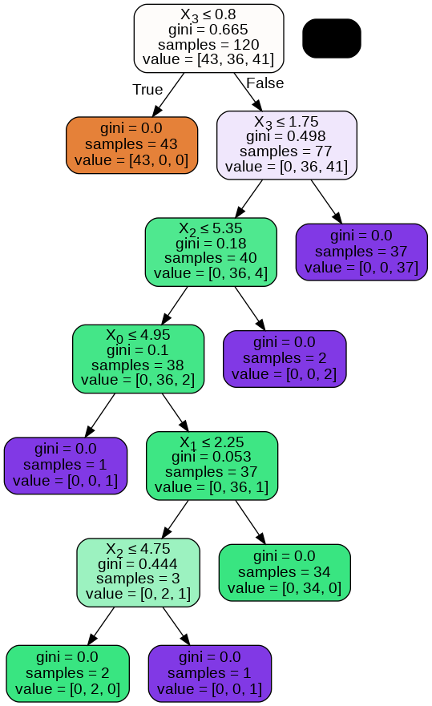
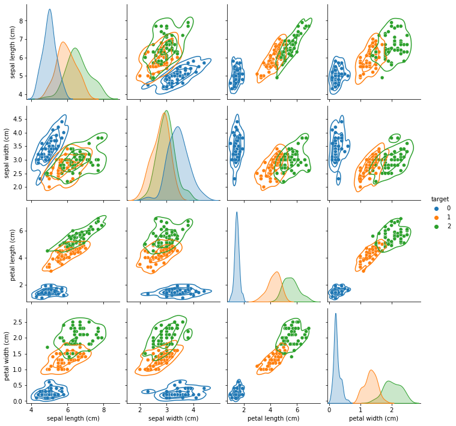
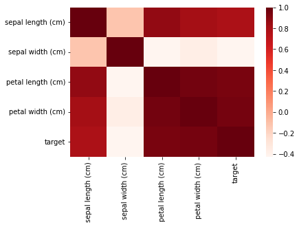

# Decision Tree Classifier

**Predicting Iris Species with a Decision Tree**

## Overview

This project trains a decision tree to predict the species of an iris flower (setosa, versicolor or virginica) from four measurements: sepal length, sepal width, petal length and petal width. It covers data checks, exploratory plots, an 80 / 20 train-test split, evaluation and two views of the fitted tree, so you can see exactly which rules the model uses.

## Repository layout

| Path | Content |
| --- | --- |
| `Decision_Tree_Classifier.ipynb` | All code; every figure and table is produced here |
| `Iris.csv` | A copy of the Iris data (the notebook loads the same data from scikit-learn) |
| `figures/` | Figures exported from the notebook |
| `FlowChart.png` | Overview of the workflow |

## Dataset

The classic [Iris dataset](https://archive.ics.uci.edu/dataset/53/iris): 150 flowers × 4 numeric features, 50 of each species, no missing values.

## How to run

1. Install the libraries: `pip install scikit-learn pandas numpy matplotlib seaborn six pydotplus`, plus [Graphviz](https://graphviz.org/download/) for the tree image
2. Open `Decision_Tree_Classifier.ipynb` and run all cells

The split has no fixed random seed, so each run uses a different 30-flower test set and the numbers can change slightly.

## Notebook structure

| Section | Content |
| --- | --- |
| Loading and checks | Load data, inspect head, tail and types, check for missing values |
| Visualisation | Pair plot with density contours, class pie chart, correlation heat map |
| Preparation | 120 training and 30 test flowers (80 / 20 split) |
| Model | `DecisionTreeClassifier(max_depth=10, random_state=2)`, confusion matrix, classification report |
| Tree | Graphical tree (Graphviz) and the same rules as text |

## Key results

| Measure | Result |
| --- | --- |
| Test accuracy | 90.0% (27 of 30 flowers) |
| Macro F1 | 0.91 |
| Setosa | Precision 1.00, recall 1.00 |
| Versicolor | Precision 0.92, recall 0.86 |
| Virginica | Precision 0.80, recall 0.89 |

All three mistakes are between versicolor and virginica, the two species whose measurements overlap.

## Results in figures

**One petal rule separates setosa from the rest.** The root split (petal width ≤ 0.8 cm) puts all 43 training setosa flowers in one pure leaf; the remaining splits separate versicolor from virginica. The tree ends with 7 leaves.

**Petal measurements separate the species best**, while sepal width overlaps heavily between them.

